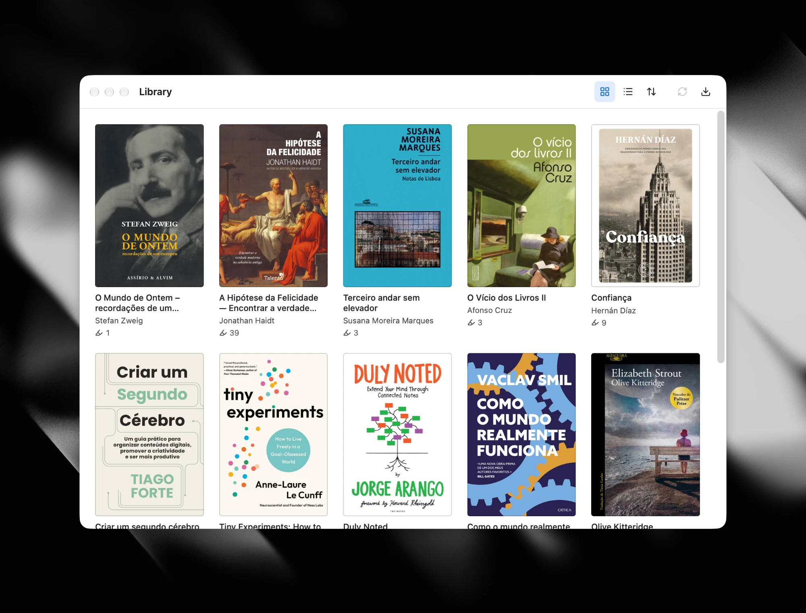

# Khi

A native macOS app that keeps the highlights from your Kobo in a Library on your Mac and exports them to Markdown.



## Features

- **A Library that outlives your Kobo.** Every sync adds the new highlights to a Library on your Mac. You can browse it with your Kobo unplugged.
- **Highlights removed from your Kobo stay.** Kobo loses highlights when a book is deleted or the device is reset. Khi keeps them and marks them “Removed from Kobo”.
- **New highlights first.** After a sync, the Library says how many highlights are new and in how many books, with a single button to export just those books.
- **One Library per reader.** Each person in the house has their own Library. A Kobo is assigned to a reader the first time you connect it, and one reader can have several Kobos.
- **Markdown export.** One file per book, with the metadata you choose, your notes under their quotes, and the chapter and position of each highlight.
- **Native on macOS.** A menu bar with keyboard shortcuts, light and dark themes, your choice of accent color, and English or Portuguese, which also sets the language of the exported Markdown.
- **Automatic updates.** Khi checks for signed updates once a day and installs them when you agree.
- **Read-only access to your Kobo.** Khi opens your Kobo’s database read-only.

## Requirements

- A Mac with Apple silicon
- macOS 13.3 (Ventura) or later
- A Kobo e-reader that connects over USB (developed with a Kobo Libra II)

## Installation

1. Download the `.dmg` from the latest [release](../../releases/latest).
2. Open it and drag Khi to the Applications folder.

Khi is signed and notarized by Apple, so it opens without a security warning.

## Usage

### Sync your Kobo

1. Connect your Kobo to your Mac with a USB cable.
2. The first Kobo you connect creates a reader, named after the device. You can rename it in Settings › Kobo. When you connect a Kobo that Khi doesn’t know yet, Khi asks “Whose Kobo is this?”. Choose a reader or create a new one.
3. Khi syncs your highlights into that reader’s Library. Later syncs happen when you connect a known Kobo, or when you choose **Sync with Kobo** (⌘R).

To sync by hand only, turn off **Sync on connect** in Settings › Kobo.

### Browse the Library

- Switch between the grid (⌘1) and the list (⌘2), and sort by title, author, most recently read or number of highlights.
- Books with new highlights show a “new” count on the cover.
- Open a book to read its highlights. Filter them by **All**, **New** or **With notes**, and copy any quote.
- Once every highlight of a book has been removed from your Kobo, you can delete the book from the Library (⌘⌫).

### Export

- **Export N Books**, at the top of the Library, exports the books with new highlights. Exporting clears their “new” marks.
- The export button in the toolbar (⌘E) exports the open book, otherwise the books selected in the list, otherwise the whole Library. In the list, select books with ⌘-click or Shift-click.
- **File › Show Last Export in Finder** opens the folder with the files selected.

Each reader’s books go to `~/Documents/Kobo Highlights/<reader name>` by default. You can choose another folder in Settings › Export.

### Keyboard shortcuts

| Shortcut | Action |
|---|---|
| ⌘, | Settings |
| ⌘R | Sync with Kobo |
| ⌘E | Export |
| ⌘1 | View as Grid |
| ⌘2 | View as List |
| ⌘[ | Back to Library |
| ⌘⌫ | Delete Book… |

## Exported Markdown

Each book is saved as `<Title> - <Author>.md`. With every metadata field turned on, a book looks like this:

```markdown
# Test Book

**Author**: Test Author
**ISBN**: 978-1234567890
**Publisher**: Test Publisher
**Last read**: 24 January 2025
**Language**: en

A test book description

---

> First highlight

**Note:** A thought  
second line

Chapter 1 · 25%

> Second highlight

Chapter 1 · 50%
```

- Settings › Export chooses which metadata to include (author, ISBN, publisher, last read date, language, description) and the date format: `24/01/2025`, `24 January 2025` or ISO 8601 (`2025-01-24`).
- The labels and month names follow the app’s language. In Portuguese the same book has `**Autor**`, `**Data de leitura**: 24 de janeiro de 2025` and `**Nota:**`.
- The same books and settings always produce the same bytes, so the files work well in Git or a notes vault.

## Settings

| Pane | What it sets |
|---|---|
| Export | The export folder, the metadata to include and the date format |
| Appearance | Theme, accent color and language |
| Kobo | The reader’s name and Sync on connect |
| Updates | The daily check, the installed version and Check Now |

## Where Khi keeps your data

Your Library and settings are in `~/Library/Application Support/KoboHighlightsExporter/`:

- `library.sqlite`, the Library of every reader;
- `covers/`, the covers taken from your Kobo’s books;
- `settings.json`.

Deleting this folder removes every reader’s Library and settings. The exported Markdown files stay. The log is at `~/Library/Logs/com.bruno.kobo-highlights-exporter/app.log`.

## Development

### Prerequisites

- macOS with the Xcode Command Line Tools (`xcode-select --install`)
- [Node.js](https://nodejs.org/) 20, 22 or 24+
- [Rust](https://rustup.rs/), stable

### Run

```bash
npm ci
```

```bash
npm run dev:app
```

`dev:app` runs **Khi Dev**, with its own identifier and its own data folder (`KoboHighlightsExporter Dev`). A debug build never reads or writes the Library of the installed app.

### Checks

```bash
npx vitest run
```

```bash
npm run check
```

```bash
npm run test:visual
```

```bash
(cd src-tauri && cargo test)
```

```bash
(cd src-tauri && cargo clippy --all-targets)
```

`test:visual` needs Playwright’s Chromium (`npx playwright install chromium`). It builds the frontend and compares every screen, in the light, dark and system-dark themes, with the baselines in `tests/visual/baseline/`. The baselines were recorded on macOS. After an intended change, update a scenario with `npm run test:visual:update -- -g <name>`.

### Build

To build Khi Dev as a standalone app, without the updater artifacts:

```bash
npx tauri build --debug --config src-tauri/tauri.dev.conf.json --config '{"bundle":{"createUpdaterArtifacts":false}}' --bundles app
```

The app is written to `src-tauri/target/debug/bundle/macos/`. A release build uses the real identifier and data folder, and needs the updater signing key and Apple’s notarization credentials (see `BUILD.md`).

## Architecture

**Frontend:** SvelteKit with `adapter-static`, as a single-page app inside Tauri 2. It uses Svelte 5, TypeScript, Tailwind CSS 4 and Bits UI.

| Path | Contents |
|---|---|
| `src/routes/+page.svelte` | The main window: Library, book, sync and export |
| `src/routes/definicoes/` | The Settings window |
| `src/lib/components/` | Screens, dialogs and the `ui/` components |
| `src/lib/menu.ts`, `menu-state.ts` | The native menu bar and when each item is enabled |
| `src/lib/i18n/locales/` | English and Portuguese strings |

**Backend (Rust):**

| Module | Contents |
|---|---|
| `device/` | Detects your Kobo when it is mounted |
| `db/` | Reads `KoboReader.sqlite` read-only |
| `library/` | The persistent Library: readers, books, highlights, sync |
| `covers/` | Cover extraction and cache |
| `export/` | Markdown generation |
| `settings/` | Settings and the data folder |
| `commands/` | The Tauri commands the frontend calls |

Design decisions are recorded in `docs/adr/`, and the domain terms in `GLOSSARY.md`.

## License

MIT

---

Khi is an independent project. It is not affiliated with Rakuten Kobo.
